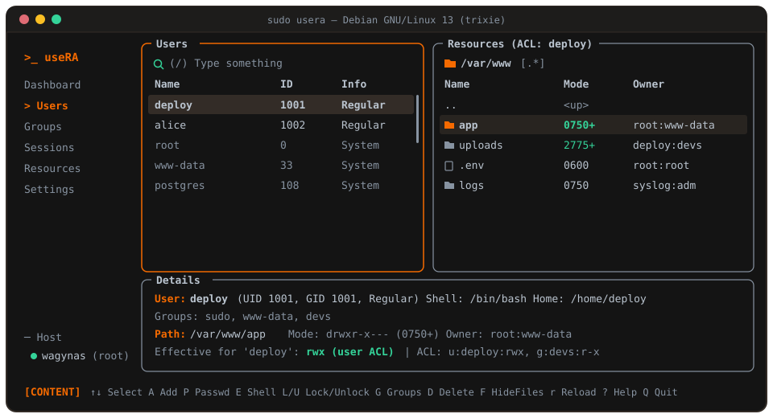

# useRA

**Modern Linux User, Group, Permission & POSIX ACL Manager (TUI)**

> User & Access Management, Simplified.

**useRA** adalah aplikasi Terminal User Interface (TUI) berbahasa **Rust** (Ratatui + Crossterm) untuk mengelola akun Linux, grup, login session, hak akses file (`chmod`/`chown`), dan POSIX ACL (`getfacl`/`setfacl`) dalam satu antarmuka keyboard-first yang terinspirasi oleh **Superfile**.

Dibangun untuk administrator **Debian 12 (bookworm)** dan **Debian 13 (trixie)** sebagai **standalone binary** yang cepat, tanpa runtime eksternal, serta mengutamakan keamanan operasi sistem.

### Kenapa useRA?

- **Semua terhubung di satu layar (Mode Hybrid):** Sorot seorang user atau grup di panel tengah, langsung lihat dan atur akses folder/file milik mereka di panel kanan beserta kalkulasi izin efektif (`Effective for 'deploy': rwx`) di panel bawah.
- **Tanpa hafal sintaks `chmod` / `setfacl`:** Pengaturan mode pakai **checkbox grid 3×3 (`r/w/x` + `SUID/SGID/Sticky`)**, pengaturan ACL pakai **Scope selector + autocomplete user/group** + checkbox `Default (d:)`, dan hapus ACL langsung lewat checklist entri aktif.
- **Aman untuk sistem produksi:** Tidak membaca `/etc/shadow`, tidak melakukan auto-elevation (`sudo usera` untuk tulis, read-only tanpa root), menolak hapus/kunci akun sistem (`UID < 1000`), memblokir operasi rekursif `-R` pada path kritis OS (`/`, `/etc`, `/usr`, `/var`, dll.), dan mencatat seluruh aksi di `audit.log` (`0600`).
- **Live search & responsif:** Filter instan dengan `/` di `Users`, `Groups`, `Sessions`, dan `Resources`; mendukung scrolling tabel & scrollbar penuh.

---

## Tampilan Antarmuka



*Mode **Hybrid** pada terminal lebar ($\ge 105 \times 24$): navigasi borderless di kiri, daftar akun & search bar di tengah, Resource Manager (`0750+` menandakan POSIX ACL aktif) di kanan, dan ringkasan akun + izin efektif di bawah. Untuk fokus penuh ke filesystem di ukuran terminal berapa saja, buka halaman **Resources** di sidebar.*

---

## Instalasi & Update

### 1. Quick Install (Prebuilt Binary x86_64)

Jalankan one-liner berikut (mengunduh rilis terbaru dari GitHub Releases dan memverifikasi checksum SHA-256 secara otomatis):

```sh
bash -c "$(curl -fsSL https://raw.githubusercontent.com/munMisbah/useRA/main/install.sh)"
```

Binary dipasang ke `/usr/local/bin/usera` (dengan `sudo` jika diperlukan) atau `~/.local/bin/usera` untuk instalasi user-local.

### 2. Update & Opsi CLI

Jika sudah pernah menginstall, cukup jalankan:

```sh
usera update        # atau: sudo usera update (jika di /usr/local/bin)
usera --version     # cek versi terpasang (v1.2.0)
usera --help        # ringkasan perintah CLI
```

`usera update` mengecek tag rilis terbaru terlebih dahulu (tidak mengunduh ulang jika sudah mutakhir), memverifikasi SHA-256 pada artefak ter-pin versi, dan memperbarui binary tanpa menjalankan remote shell script.

### 3. Build dari Source

Prasyarat build: **Rust $\ge 1.88$** (`rustup`), `build-essential`, dan (opsional untuk fitur POSIX ACL) paket `acl`:

```sh
sudo apt install build-essential acl   # paket acl opsional untuk getfacl/setfacl
git clone https://github.com/munMisbah/useRA.git
cd useRA
cargo build --release
sudo install -m 755 target/release/usera /usr/local/bin/usera
```

### 4. Kebutuhan Nerd Font

useRA menggunakan ikon **Nerd Font** (untuk tampilan folder, user, grup, dan pencarian). Tanpa Nerd Font, ikon tampil sebagai kotak (*tofu*), meski seluruh fungsi tetap berjalan.

```sh
./scripts/check-font.sh
```

Lihat panduan instalasi font lokal di [docs/INSTALL.md](docs/INSTALL.md).

---

## Cara Pakai & Shortcut Keyboard

Jalankan sesuai kebutuhan hak akses:

```sh
usera         # mode read-only (inspeksi user, grup, session, permission & ACL)
sudo usera    # mode administratif penuh (tulis + audit log)
```

### Navigasi Global

| Tombol | Aksi |
| --- | --- |
| `↑` / `↓` | Pilih halaman (di Sidebar) atau baris data |
| `←` / `→` / `Tab` / `Shift+Tab` | Pindah fokus antar panel (`Sidebar` $\leftrightarrow$ `Content` $\leftrightarrow$ `Right/Resources`) |
| `/` | Pencarian live (`Users`, `Groups`, `Sessions`, `Resources`) |
| `r` | Reload data sistem *(kecuali di `Groups` untuk hapus member)* |
| `Esc` | Hapus filter pencarian / tutup modal / bersihkan notifikasi |
| `?` | Tampilkan modal bantuan shortcut |
| `q` / `Ctrl+C` | Keluar |

### Manajemen User (`Users`, butuh root untuk tulis)

| Tombol | Aksi |
| --- | --- |
| `A` | Tambah user (`useradd`: username, full name, home, shell, groups, password opsional masked) |
| `P` | Set / ubah password user terpilih (masked + konfirmasi, dikirim via stdin ke `chpasswd`) |
| `E` | Ubah login shell (`usermod -s`, validasi absolute path) |
| `L` / `U` | Lock / Unlock akun (`passwd -l` / `passwd -u`, konfirmasi `YES`) |
| `G` | Tambah user ke supplementary groups (`usermod -aG`) |
| `X` | Set / hapus tanggal kedaluwarsa akun (`chage -E YYYY-MM-DD`) |
| `D` | Hapus user (`userdel`, konfirmasi `YES`; home directory dipertahankan) |

### Manajemen Grup (`Groups`, butuh root untuk tulis)

| Tombol | Aksi |
| --- | --- |
| `A` | Buat grup baru (`groupadd`, GID opsional) |
| `E` | Ubah nama grup (`groupmod -n`) |
| `G` | Tambah member grup (`gpasswd -a`, pisahkan dengan koma) |
| `R` | Hapus member grup (`gpasswd -d`, terisi daftar member saat ini) |
| `D` | Hapus grup (`groupdel`, konfirmasi `YES`; akun user tidak dihapus) |

### Resource & POSIX ACL Manager (`Resources` & panel Hybrid kanan)

| Tombol | Aksi |
| --- | --- |
| `F` | Toggle panel Resources di samping `Users` / `Groups` (aktif otomatis jika terminal $\ge 105 \times 24$) |
| `Space` | Tandai / multi-select beberapa folder atau file untuk aksi batch (`A`/`X`/`B`/`M`/`O`) |
| `Enter` / `⌫` (`-`) | Masuk direktori / naik ke parent direktori |
| `G` / `H` / `.` | Lompat path / lompat ke home user terpilih (Hybrid) / tampilkan-sembunyikan dotfiles |
| `M` | Ubah mode (`chmod` checkbox 3×3 + `SUID`/`SGID`/`Sticky` + opsi rekursif `YES`) |
| `O` | Ubah owner/group (`chown -h`, + opsi rekursif `YES`) |
| `A` | Set/edit POSIX ACL (`setfacl -m`: Scope, autocomplete 1+ huruf via `Enter`/`Tab`, auto-load ACL aktif, `r/w/x/X`, `Access` & `Default d:` sekaligus) |
| `X` | Hapus POSIX ACL (`setfacl -x` / `-k` lewat checklist entri aktif) |
| `B` | Bersihkan seluruh extended ACL (`setfacl -b`, konfirmasi `YES`) |
| `C` / `V` | Salin ACL dari item (`getfacl -c -p -P`) / tempel ACL ke target tunggal atau multi-select (`setfacl --set-file=-`, konfirmasi `YES`) |

---

## Model Keamanan & Audit

- **No Auto-Elevation:** Write operation hanya diizinkan saat dijalankan dengan `sudo usera`.
- **Privasi Credential:** Password diinput dalam mode masked (`•`), dikirim lewat pipe `stdin` ke `chpasswd`, tidak pernah muncul di argumen CLI (`/proc/PID/cmdline`) maupun di file log, dan `/etc/shadow` tidak pernah dibaca.
- **Audit Log Terproteksi:** Setiap operasi tulis dicatat ke `/var/log/usera/audit.log` (root) atau `$XDG_STATE_HOME/usera/audit.log` dengan permission eksplisit direktori `0750`, file `0600`, serta proteksi anti-symlink (`symlink_metadata`).
- **System Guards:** Menolak hapus/kunci akun `root` (`UID 0`) & system accounts (`UID < 1000`), menolak shell/home non-absolute, memisahkan argumen CLI dengan `--`, serta memblokir `-R` pada path root sistem (`/`, `/bin`, `/boot`, `/dev`, `/etc`, `/lib*`, `/proc`, `/root`, `/run`, `/sbin`, `/sys`, `/usr`, `/var`).

---

## Ringkasan Teknis & Dokumentasi

| Properti | Keterangan |
| --- | --- |
| Versi Saat Ini | `1.2.0` (lihat [CHANGELOG.md](CHANGELOG.md)) |
| Platform Target | Debian 12 (bookworm) & Debian 13 (trixie), `x86_64` |
| Integrasi Sistem | `getent`, `uname`, `loginctl`, `useradd`/`usermod`/`userdel`, `groupadd`/`groupmod`/`groupdel`, `gpasswd`, `passwd`, `chage`, `chpasswd`, `chmod`, `chown`, `getfacl`/`setfacl` |
| Lisensi | MIT |

Dokumentasi teknis lengkap tersedia di direktori `docs/`:

- [docs/PROJECT_SPECS.md](docs/PROJECT_SPECS.md) — Spesifikasi produk & batasan rilis.
- [docs/ARCHITECTURE.md](docs/ARCHITECTURE.md) — Struktur modul & arsitektur berlapis.
- [docs/UI_DESIGN.md](docs/UI_DESIGN.md) — Desain layout split-panel & palet warna.
- [docs/FEATURES.md](docs/FEATURES.md) — Matriks fitur yang diimplementasikan.
- [docs/SECURITY.md](docs/SECURITY.md) — Kebijakan keamanan & audit logging.
- [docs/ROADMAP.md](docs/ROADMAP.md) — Riwayat fase pengembangan (Phase 0–7).
- [docs/INSTALL.md](docs/INSTALL.md) — Panduan instalasi & setup Nerd Font.
- [docs/MANUAL.md](docs/MANUAL.md) — Manual penggunaan lengkap.
